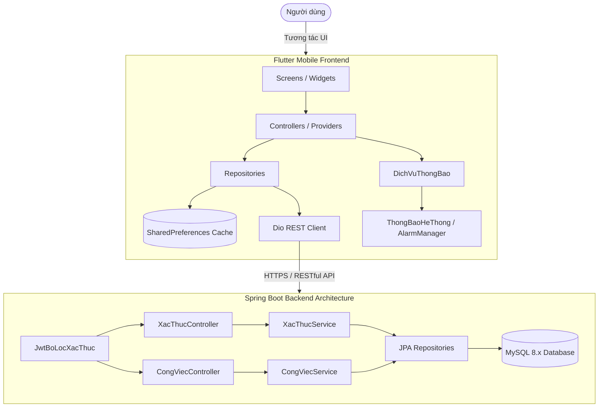

# ⏰ TIMASS - HỆ THỐNG QUẢN LÝ THỜI GIAN & LỊCH TRÌNH THÔNG MINH
> **Time Management & Scheduling System (Timass)**  
> Ứng dụng di động quản lý lịch biểu tuần, danh sách checklist tiến độ và hệ thống thông báo nhắc nhở đa tầng, kết nối với Backend Spring Boot & MySQL.

---
   
## 📌 MỤC LỤC
1. [Giới thiệu tổng quan](#-1-giới-thiệu-tổng-quan)
2. [Tính năng nổi bật](#-2-tính-năng-nổi-bật)
3. [Công nghệ sử dụng](#-3-công-nghệ-sử-dụng)
4. [Kiến trúc hệ thống & Quy chuẩn AI_rules.md](#-4-kiến-trúc-hệ-thống--quy-chuẩn-ai_rulesmd)
5. [Cấu trúc thư mục dự án](#-5-cấu-trúc-thư-mục-dự-án)
6. [Hệ thống thông báo đa tầng](#-6-hệ-thống-thông-báo-đa-tầng)
7. [Hướng dẫn cài đặt & Khởi chạy](#-7-hướng-dẫn-cài-đặt--khởi-chạy)
8. [Bộ kiểm thử tự động (Automated Tests)](#-8-bộ-kiểm-thử-tự-động-automated-tests)
9. [Lưu ý kỹ thuật quan trọng](#-9-lưu-ý-kỹ-thuật-quan-trọng)

---

## 📖 1. GIỚI THIỆU TỔNG QUAN

**Timass** là giải pháp quản lý thời gian hiện đại được thiết kế theo phong cách tối giản, thanh lịch với tông màu chủ đạo **Sage Green** và **Cam Đào Pastel**. Ứng dụng giúp người dùng trực quan hóa toàn bộ kế hoạch học tập, làm việc và sinh hoạt hàng ngày thông qua ma trận lịch tuần 7 ngày trực quan, phân loại rành mạch giữa các công việc **Chủ động** (học tập, dự án, tập thể thao) và công việc **Thiết yếu / Bị động** (ăn uống, ngủ nghỉ, di chuyển).

---

## ✨ 2. TÍNH NĂNG NỔI BẬT

### 2.1. Ma trận Lịch tuần & Lịch tháng thời gian thực (Real-time Timeline)
- **Lưới thời gian 7 ngày (Weekly Grid)**:
  - Cột thời gian chi tiết từ 06:00 đến 22:00.
  - Vạch đỏ chỉ giờ thực tế (`Current Time Indicator`) tự động cập nhật từng phút kèm nhãn giờ hiện tại.
  - Tự động cuộn thông minh đến gần mốc giờ hiện tại khi mở màn hình.
  - Đánh dấu nổi bật ngày hôm nay (`pill badge`) trên thanh thứ ngày.
- **Chuyển đổi Lịch tuần & Lịch tháng (`Segmented ViewSwitcher`)**:
  - Chuyển đổi mượt mà bằng thanh trượt animated giữa chế độ Lưới tuần và Ma trận tháng 35 ngày.
  - Ma trận lịch tháng hiển thị trực quan các chấm màu đại diện cho công việc trong từng ngày.
- **Điều hướng thời gian**: Dễ dàng nhảy về tuần trước, tuần sau hoặc bấm nút **"Hôm nay" (Today)** để quay lại tức thì.

### 2.2. Quản lý Sự kiện & Chuỗi công việc lặp lại (Recurring Events)
- **Thêm & Sửa công việc linh hoạt**:
  - Modal Bottom Sheet thiết kế cao cấp, hỗ trợ chọn ngày, khung giờ bắt đầu - kết thúc, địa điểm, ghi chú và thời gian nhắc nhở.
  - Phân loại công việc: **Chủ động** (Active) vs. **Thiết yếu / Bị động** (Essential / Passive).
- **Thuật toán kiểm tra trùng lịch (`TimeConflictChecker`)**:
  - Tự động phát hiện xung đột thời gian (giao thoa, bao trùm, lồng khung giờ) và cảnh báo bằng hộp thoại `ConflictWarningDialog` cho phép người dùng điều chỉnh hoặc vẫn tiếp tục lưu.
- **Quản lý chuỗi sự kiện lặp (`BatchEventHelper`)**:
  - Hỗ trợ lặp theo các thứ trong tuần (Thứ 2, Thứ 4, Thứ 6...).
  - Khi chỉnh sửa hoặc xóa sự kiện lặp, hộp thoại `RecurringChoiceDialog` cung cấp 2 lựa chọn:
    1. **Chỉ áp dụng cho sự kiện này** (Tách khỏi chuỗi lặp).
    2. **Áp dụng cho toàn bộ chuỗi lặp** (Cập nhật đồng bộ toàn bộ các buổi học/làm việc trong chuỗi hoặc tái sinh lịch mới nếu đổi thứ).

### 2.3. Checklist Tiến độ hàng ngày (`ChecklistScreen`)
- **Card tiến độ tổng quan**: Vòng tròn phần trăm hoàn thành, thống kê số việc đã xong / tổng số việc trong ngày.
- **Optimistic UI Update**: Chạm để đánh dấu hoàn thành tức thì, tự động hoàn tác (rollback) nếu có lỗi.
- **Tự động tích việc thiết yếu (Auto-complete Passive Events)**: Tự động đánh dấu hoàn thành các công việc thiết yếu (ăn, ngủ, nghỉ) khi thời gian thực tế đã vượt qua giờ kết thúc.

### 2.4. Đa ngôn ngữ (Bilingual: Tiếng Việt & English)
- Hỗ trợ chuyển đổi song ngữ 100% không cần khởi động lại app.
- Bản địa hóa toàn bộ giao diện: Tiêu đề, nhãn, nút bấm, bộ chọn ngày giờ (Date/Time Picker), thông báo SnackBar, dialog xác nhận và popup nhắc nhở.

### 2.5. Giao diện Tối & Chuyển cảnh mượt mà (Dark Mode & Silky Transitions)
- **Adaptive Dark Mode**: Tông màu nền Slate tối ưu độ tương phản, bảo vệ mắt ban đêm, hiển thị chữ và số sáng rõ.
- **Chuyển cảnh chuẩn Material 3 & iOS (`SmoothSlideTransitionsBuilder`)**:
  - Hiệu ứng trượt nhẹ 6% kết hợp mờ dần (Subtle Slide & Fade) loại bỏ hoàn toàn độ giật cục và hiện tượng nhấp nháy trắng khi chuyển màn hình.
  - Phản hồi xúc giác rung nhẹ (`HapticFeedback`) khi chạm và kích hoạt thông báo.

### 2.6. Khả năng hoạt động Ngoại tuyến (Offline-First Cache)
- Tự động đồng bộ và lưu trữ lịch tuần dưới dạng chuỗi JSON mã hóa trong `SharedPreferences`.
- Khi không có mạng, ứng dụng nạp ngay dữ liệu ngoại tuyến từ cache giúp người dùng luôn xem được lịch trình mà không bị gián đoạn.

---

## 🛠 3. CÔNG NGHỆ SỬ DỤNG

### Frontend (Mobile App)
| Thành phần | Phiên bản / Thư viện | Vai trò |
|---|---|---|
| **Framework** | Flutter 3.38.5 (Dart 3.10+) | Lập trình ứng dụng di động đa nền tảng |
| **State Management** | `provider: ^6.1.2` | Quản lý trạng thái phân tầng, Reactive UI |
| **Networking** | `dio: ^5.7.0` | HTTP Client, Interceptors gắn JWT Token |
| **Offline Cache** | `shared_preferences: ^2.3.2` | Bộ nhớ cục bộ lưu trữ Token, Cài đặt, Lịch tuần |
| **Hệ thống thông báo** | `flutter_local_notifications: ^22.3.3` | Báo thức chính xác (Exact Alarm), Heads-up Lockscreen |
| **Múi giờ & Lịch hẹn** | `timezone: ^0.11.2` | Định dạng và tính toán thời gian báo thức |
| **Định dạng thời gian** | `intl: ^0.19.0` | Format ngày tháng, giờ, số tuần ISO |
| **Mã hóa** | `crypto: ^3.0.3` | Hashing và bảo mật dữ liệu |

### Backend (Server REST API)
| Thành phần | Phiên bản / Thư viện | Vai trò |
|---|---|---|
| **Ngôn ngữ & Nền tảng** | Java 17+, Spring Boot 3.x | Xây dựng RESTful API Server |
| **Bảo mật** | Spring Security 6.x, JWT (jjwt) | Xác thực Stateless, mã hóa mật khẩu BCrypt |
| **ORM & Database** | Spring Data JPA, Hibernate, MySQL 8.x | Ánh xạ cơ sở dữ liệu quan hệ |
| **Build Tool** | Apache Maven | Quản lý dependencies và đóng gói dự án |

---

## 📐 4. KIẾN TRÚC HỆ THỐNG & QUY CHUẨN AI_RULES.MD

Dự án tuân thủ nghiêm ngặt theo tài liệu tiêu chuẩn [`AI_rules.md`](file:///d:/laptrinh/dart/timass/AI_rules.md):



### Quy ước đặt tên bắt buộc
1. **Biến, Thuộc tính & Tham số**: Sử dụng **TIẾNG VIỆT KHÔNG DẤU** theo chuẩn `camelCase` trên cả Backend và Mobile:
   - *Ví dụ*: `soDienThoai`, `matKhau`, `tenCongViec`, `thoiGianBatDau`, `thoiGianKetThuc`, `daHoanThanh`, `laThietYeu`, `maNguoiDung`.
2. **Cơ sở dữ liệu MySQL**: Chuẩn `snake_case` số ít:
   - *Tên bảng*: `nguoi_dung`, `cong_viec`, `cong_viec_con`, `quy_tac_lap`.
   - *Tên cột*: `id`, `so_dien_thoai`, `mat_khau`, `ten_cong_viec`, `thoi_gian_bat_dau`, `thoi_gian_ket_thuc`, `da_hoan_thanh`, `la_thiet_yeu`, `ngay_tao`.
3. **Endpoint API**: Chuẩn `kebab-case` với tiền tố `/api/v1`:
   - Xác thực: `POST /api/v1/xac-thuc/dang-ky`, `POST /api/v1/xac-thuc/dang-nhap`
   - Công việc: `GET /api/v1/cong-viec/tuan`, `POST /api/v1/cong-viec`, `PUT /api/v1/cong-viec/{id}`, `DELETE /api/v1/cong-viec/{id}`
4. **Chuẩn dữ liệu phản hồi (Response Wrapper)**:
   ```json
   {
     "maTrangThai": 200,
     "thongBao": "Thành công",
     "duLieu": { ... }
   }
   ```

---

## 📁 5. CẤU TRÚC THƯ MỤC DỰ ÁN

```text
timass/
├── android/                             # Cấu hình Native Android
│   ├── app/
│   │   ├── build.gradle.kts             # Desugaring JDK Libs, MinSDK, TargetSDK
│   │   └── src/main/AndroidManifest.xml # Quyền POST_NOTIFICATIONS, EXACT_ALARM, VIBRATE
│   └── gradle/wrapper/
│       └── gradle-wrapper.properties    # Gradle 8.14 tương thích AGP 8.11.1
├── backend/                             # Mã nguồn Server Spring Boot
│   ├── src/main/java/com/timass/
│   │   ├── controller/                  # REST Controllers (XacThucController, ...)
│   │   ├── dto/                         # Data Transfer Objects & ApiResponse
│   │   ├── entity/                      # JPA Entities (NguoiDung, CongViec, QuyTacLap)
│   │   ├── repository/                  # Spring Data Repositories
│   │   ├── security/                    # SecurityConfig, JwtUtils, BoLoc
│   │   └── service/                     # Business Logic Services
│   └── pom.xml                          # Maven Configuration
├── lib/                                 # Mã nguồn Mobile Flutter
│   ├── core/                            # Cấu hình lõi & dùng chung
│   │   ├── bo_nho/                      # SharedPreferences Service (BoNhoDichVu)
│   │   ├── constants/                   # AppColors, AppStyles, AppThemes
│   │   ├── localization/                # Từ điển đa ngôn ngữ (AppTranslations)
│   │   ├── mang/                        # Dio ApiClient gắn JWT Interceptor
│   │   └── thong_bao/                   # Dịch vụ thông báo hệ thống & quét ngầm
│   │       ├── cai_dat_thong_bao_model.dart
│   │       ├── dich_vu_thong_bao.dart
│   │       └── thong_bao_he_thong.dart  # Native Local Notifications & Alarm
│   ├── features/                        # Các module tính năng (Feature-first)
│   │   ├── cai_dat/                     # Màn hình & Controller Cài đặt
│   │   ├── cong_viec/                   # Lịch tuần, Lịch tháng, Checklist, Form
│   │   │   ├── controllers/             # ScheduleController, ChecklistController, EventFormController
│   │   │   ├── models/                  # CongViecModel
│   │   │   ├── repositories/            # MockEventRepository, EventRepositoryImpl
│   │   │   ├── screens/                 # LichTuanScreen, ChecklistScreen
│   │   │   ├── utils/                   # TimeConflictChecker, BatchEventHelper
│   │   │   └── widgets/                 # WeeklyGrid, ProgressCard, ViewSwitcher...
│   │   ├── thong_bao/                   # Giao diện thông báo
│   │   │   ├── controllers/             # ThongBaoController
│   │   │   └── widgets/                 # PopupNhacNho, MessengerBanner, ChatHead...
│   │   └── xac_thuc/                    # Đăng ký, Đăng nhập, AuthGate
│   └── main.dart                        # Khởi tạo App, MultiProvider, Theme
├── test/                                # Bộ kiểm thử tự động (67 tests passed)
│   ├── auth_navigation_test.dart
│   ├── checklist_test.dart
│   ├── event_form_test.dart
│   ├── localization_event_notification_test.dart
│   ├── messenger_notification_test.dart
│   ├── month_calendar_test.dart
│   ├── settings_test.dart
│   └── widget_test.dart
├── AI_rules.md                          # Bộ quy tắc coding bắt buộc của dự án
└── pubspec.yaml                         # Khai báo thư viện & tài nguyên Flutter
```

---

## 🔔 6. HỆ THỐNG THÔNG BÁO ĐA TẦNG

Timass được trang bị hệ thống thông báo đa dạng đáp ứng đầy đủ các tình huống sử dụng:

| Kiểu thông báo | Cơ chế hoạt động | Trải nghiệm người dùng |
|---|---|---|
| **1. Thông báo hệ thống ngoài màn hình khóa (`ThongBaoHeThong`)** | Sử dụng `AlarmManager` và `flutter_local_notifications` đăng ký kênh ưu tiên cao nhất (`Importance.max`). | Hoạt động ngay cả khi **tắt màn hình điện thoại hoặc đóng ứng dụng**. Hiển thị dạng Heads-Up Banner ngoài màn hình khóa, **phát âm thanh chuông báo và rung**. |
| **2. Banner trượt đỉnh màn hình (`MessengerNotificationBanner`)** | Overlay trượt từ đỉnh xuống với hiệu ứng rơi đàn hồi (`Curves.easeOutBack`) nảy kích thước từ 90% -> 100%. | Phong cách Facebook Messenger / iOS. Hỗ trợ vuốt ngược lên để tắt, có rung haptic nhẹ khi xuất hiện. |
| **3. Bong bóng nổi kéo thả (`ChatHeadBubbleWidget`)** | Bong bóng avatar nổi lơ lửng trên màn hình, tự do kéo thả khắp các vị trí. | Tự động lướt mềm mại bám sát mép màn hình khi buông tay (`_snapToEdge`). Chạm vào để xem tóm tắt hoặc mở chi tiết. |
| **4. Hộp thoại báo thức 3D (`PopupNhacNhoDialog`)** | Popup mở giữa màn hình với hoạt họa đồng hồ báo thức 3D pastel claymorphism. | Nút "Nhắc lại sau 5 phút" (**Snooze**) và nút "Xem chi tiết". Mở bật mượt mà với hiệu ứng Elastic Pop 320ms. |
| **5. Trung tâm nhắc nhở (`HopThoaiThongBao`)** | Modal Bottom Sheet mở ra khi chạm vào Icon Chuông trên thanh tiêu đề. | Quản lý lịch sử các công việc đã thông báo, hiển thị huy hiệu chấm đỏ (Badge) khi có thông báo mới. |

---

## 🚀 7. HƯỚNG DẪN CÀI ĐẶT & KHỞI CHẠY

### 7.1. Yêu cầu môi trường (Prerequisites)
- **Flutter SDK**: Phiên bản `>= 3.24.0` (Khuyến nghị `3.38.5`).
- **Android SDK**: API Level 34+ (Android 14/15/16).
- **Java**: JDK 17 LTS (dành cho Backend Spring Boot và build Android).
- **MySQL**: Phiên bản 8.0+.
- **Công cụ hỗ trợ**: VS Code / Android Studio, Android Emulator hoặc thiết bị thật.

### 7.2. Khởi chạy Ứng dụng Di động (Flutter Mobile)
1. Mở terminal tại thư mục gốc của dự án:
   ```bash
   cd timass
   ```
2. Cài đặt các thư viện phụ thuộc:
   ```bash
   flutter pub get
   ```
3. Khởi động máy ảo Android (ví dụ `emulator-5554`) hoặc kết nối điện thoại qua USB.
4. Kiểm tra thiết bị đã sẵn sàng:
   ```bash
   flutter devices
   ```
5. Chạy ứng dụng:
   ```bash
   flutter run
   ```
   *(Hoặc nhấn `F5` trong VS Code / chọn thiết bị và bấm `Run` trong Android Studio).*

### 7.3. Khởi chạy Máy chủ Backend (Spring Boot)
1. Di chuyển vào thư mục backend:
   ```bash
   cd backend
   ```
2. Tạo cơ sở dữ liệu MySQL:
   ```sql
   CREATE DATABASE timass_db CHARACTER SET utf8mb4 COLLATE utf8mb4_unicode_ci;
   ```
3. Cấu hình thông tin tài khoản MySQL trong file `src/main/resources/application.properties`:
   ```properties
   spring.datasource.url=jdbc:mysql://localhost:3306/timass_db?useSSL=false&serverTimezone=UTC
   spring.datasource.username=root
   spring.datasource.password=mat_khau_cua_ban
   spring.jpa.hibernate.ddl-auto=update
   ```
4. Build và chạy Backend:
   ```bash
   mvn clean spring-boot:run
   ```
   *Máy chủ sẽ lắng nghe tại cổng `http://localhost:8080`.*

---

## 🧪 8. BỘ KIỂM THỬ TỰ ĐỘNG (AUTOMATED TESTS)

Dự án sở hữu bộ test tự động toàn diện bao quát 100% các tính năng quan trọng:

```bash
# Chạy toàn bộ 67 bài kiểm thử
flutter test

# Kiểm tra phân tích tĩnh chuẩn mã nguồn
flutter analyze --no-fatal-infos
```

### Danh mục các bài kiểm thử:
- **`auth_navigation_test.dart`**: Kiểm tra toàn bộ luồng đăng nhập -> điều hướng vào Dashboard -> đăng xuất an toàn -> đăng nhập lại.
- **`event_form_test.dart`**:
  - Thuật toán kiểm tra trùng lịch `TimeConflictChecker` (trùng giờ, bao trùm khung giờ, kề sát, khác ngày).
  - Khởi tạo và sinh danh sách lặp `BatchEventHelper`.
  - Cập nhật đồng loạt chuỗi sự kiện lặp (`Recurring Series Edit`) trong `MockEventRepository` và `ScheduleController`.
- **`checklist_test.dart`**: Kiểm tra tính toán tỷ lệ hoàn thành %, toggle trạng thái Optimistic UI.
- **`month_calendar_test.dart`**: Chuyển đổi mượt mà qua lại giữa Lịch tuần và Lịch tháng, điều hướng các tháng.
- **`localization_event_notification_test.dart`**:
  - Giao diện tiếng Anh và tiếng Việt trên toàn bộ form thêm/sửa, dialogs, snackbars.
  - Dark mode hiển thị chữ số màu trắng chuẩn xác.
  - Đồng bộ tự động dịch vụ thông báo khi người dùng sửa hoặc xóa công việc.
- **`settings_test.dart`**: Kiểm tra chuyển đổi ngôn ngữ, dark mode, xóa cache và lưu trạng thái vào SharedPreferences.

---

## ⚠️ 9. LƯU Ý KỸ THUẬT QUAN TRỌNG

1. **Phiên bản Gradle & AGP**:
   - Dự án sử dụng **Android Gradle Plugin (AGP) 8.11.1** đi kèm với **Gradle 8.14** (`android/gradle/wrapper/gradle-wrapper.properties`).
   - *Không tự ý nâng cấp Gradle lên bản 9.6+* vì Gradle 9.6 đã loại bỏ API nội bộ `InternalProblems` gây lỗi build task `assembleDebug`.
2. **Core Library Desugaring**:
   - Thư viện `flutter_local_notifications` yêu cầu hỗ trợ Java 8 desugaring trên Android cũ. Cấu hình đã được kích hoạt sẵn trong `android/app/build.gradle.kts` thông qua:
     ```kotlin
     compileOptions {
         isCoreLibraryDesugaringEnabled = true
     }
     dependencies {
         coreLibraryDesugaring("com.android.tools:desugar_jdk_libs:2.1.4")
     }
     ```
3. **Quyền thông báo trên Android 13+**:
   - Khi chạy lần đầu trên thiết bị thật hoặc máy ảo Android 13 trở lên, ứng dụng sẽ hiển thị hộp thoại xin cấp quyền gửi thông báo (`POST_NOTIFICATIONS`) và quyền báo thức chính xác (`SCHEDULE_EXACT_ALARM`). Hãy bấm **Cho phép (Allow)** để hệ thống chuông báo hoạt động đầy đủ khi khóa màn hình.

---

<p align="center">
  <b>© 2026 Timass Team. All rights reserved.</b><br>
  <i>Designed with ❤️ for effortless time management and productivity.</i>
</p>

